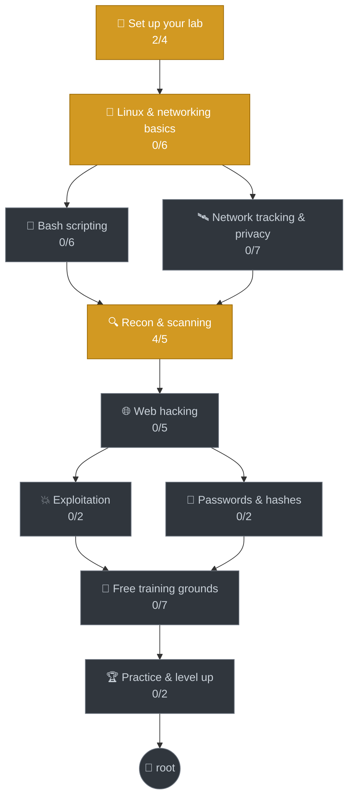

<div align="center">

# 🐉 zero-to-root

<a href="#-how-to-play"></a>

**My journey from zero to root: learning ethical hacking with Kali Linux, levelling up like a hunter, one skill at a time.**

<!--BADGES:START-->


<!--BADGES:END-->

</div>

---

## 🪪 Hunter status

<!--HUNTER:START-->
<p align="center"></p>

> **[SYSTEM]** mykali is an **E-Rank Novice Hunter**. 180 XP until level 5.  
> XP sources: Skills 800 · Quests 200 · Logs 20 · Achievements 300 · 6/18 achievements
<!--HUNTER:END-->

## ⚔️ Quests

<!--QUESTS:START-->
| | Quest | Rank | Reward | Trial |
|---|---|---|---|---|
| ✅ | The Awakening | E | +200 XP |  |
| ⚔️ | **First Scan** | E | +200 XP | `./hunter quiz nmap` |
| ⚔️ | **Shell Initiate** | E | +300 XP | `./hunter quiz linux` |
| 🔒 | _Packet Whisperer_ | D | +300 XP | `./hunter quiz networking` |
| 🔒 | _Scriptsmith_ | D | +300 XP | `./hunter quiz bash` |
| 🔒 | _Dungeon Gate: Home Lab_ | D | +400 XP |  |
| 🔒 | _Enter the Dungeon_ | D | +300 XP |  |
| 🔒 | _Ghost Protocol_ | D | +400 XP | `./hunter quiz privacy` |

<details>
<summary>⚔️ <b>First Scan</b> objectives</summary>

- [ ] Scan your own machine with nmap
- [ ] Watch port 22 flip from closed to open
- [ ] Run -A against scanme.nmap.org and save the result
- [ ] Pass the nmap quiz (80%+)

</details>

<details>
<summary>⚔️ <b>Shell Initiate</b> objectives</summary>

- [ ] Clear OverTheWire Bandit levels 0 to 5
- [ ] Add 5 new commands to cheatsheets/linux.md
- [ ] Pass the linux quiz (80%+)

</details>
<!--QUESTS:END-->

## ⚡ Progress

<!--PROGRESS:START-->
```text
Overall      ████░░░░░░░░░░░░░░░░░░░░░░░░░░   13%  (6/46 skills)
Must-knows ⭐ ████░░░░░░░░░░░░░░░░░░░░░░░░░░   13%  (4/30)
In progress  🔥 4 skills
```

| | Path | Progress | | Status |
|---|---|---|---|---|
| 🧪 | **1. Set up your lab** | `█████░░░░░` | 2/4 | 🔥 In progress |
| 🐧 | **2. Linux & networking basics** | `░░░░░░░░░░` | 0/6 | 🔥 In progress |
| 🐚 | **3. Bash scripting** | `░░░░░░░░░░` | 0/6 | 🔒 Locked |
| 🛰️ | **4. Network tracking & privacy** | `░░░░░░░░░░` | 0/7 | 🔒 Locked |
| 🏯 | **5. Free training grounds** | `░░░░░░░░░░` | 0/7 | 🔒 Locked |
| 🔍 | **6. Recon & scanning** | `████████░░` | 4/5 | 🔥 In progress |
| 🌐 | **7. Web hacking** | `░░░░░░░░░░` | 0/5 | 🔒 Locked |
| 💥 | **8. Exploitation** | `░░░░░░░░░░` | 0/2 | 🔒 Locked |
| 🔑 | **9. Passwords & hashes** | `░░░░░░░░░░` | 0/2 | 🔒 Locked |
| 🏆 | **10. Practice & level up** | `░░░░░░░░░░` | 0/2 | 🔒 Locked |
<!--PROGRESS:END-->

## 🌳 Skill tree

<!--ROADMAP:START-->


<sub>🟩 complete · 🟨 in progress · ⬛ locked</sub>

<details>
<summary><b>📋 Every skill</b> (✅ done · 🔥 working on it · 🔒 later · ⭐ must-know)</summary>

**🧪 1. Set up your lab**

- ✅ Install Kali in VirtualBox ⭐
- ✅ Fix the Hyper-V / VBS conflict
- 🔥 Update Kali and check the internet ⭐
- 🔥 Build a home lab (Metasploitable 2 + DVWA) ⭐

**🐧 2. Linux & networking basics**

- 🔥 Linux command line (OverTheWire Bandit) ⭐
- 🔒 Files, folders and permissions ⭐
- 🔒 Users, sudo and root ⭐
- 🔒 Processes, services and packages
- 🔒 How networks work (IP, TCP/UDP, ports, DNS) ⭐
- 🔒 Wireshark - watch real packets

**🐚 3. Bash scripting**

- 🔒 Variables, echo and read ⭐
- 🔒 If/else and tests ⭐
- 🔒 Loops (for and while) ⭐
- 🔒 Functions and script arguments
- 🔒 Text tools (grep, cut, sort, awk) ⭐
- 🔒 Build your own lab helper script

**🛰️ 4. Network tracking & privacy**

- 🔒 How IP geolocation works (look up your own IP) ⭐
- 🔒 Public vs private IP, NAT and your router ⭐
- 🔒 How games connect: P2P vs relay vs dedicated servers ⭐
- 🔒 What Discord and chat apps can and can't reveal
- 🔒 Watch your own traffic with Wireshark
- 🔒 OSINT yourself (what your usernames reveal) ⭐
- 🔒 Lock it down: VPN, privacy settings, router ⭐

**🏯 5. Free training grounds**

- 🔒 picoGym: solve 25 beginner challenges ⭐
- 🔒 OverTheWire Leviathan (Linux tricks)
- 🔒 OverTheWire Natas 0-10 (web basics) ⭐
- 🔒 PortSwigger Academy: first 10 labs ⭐
- 🔒 OWASP Juice Shop: 10 challenges in your lab
- 🔒 VulnHub: root Basic Pentesting 1 ⭐
- 🔒 VulnHub: root DC-1

**🔍 6. Recon & scanning**

- ✅ Scan your own machine ⭐
- ✅ Open vs closed vs filtered ⭐
- ✅ Version detection with -sV ⭐
- ✅ Aggressive scan (-A) and saving results
- 🔥 All ports, UDP and NSE scripts ⭐

**🌐 7. Web hacking**

- 🔒 How websites work (HTTP, cookies, sessions) ⭐
- 🔒 Burp Suite - intercept web requests ⭐
- 🔒 Find hidden pages with gobuster / ffuf
- 🔒 SQL injection (by hand, then sqlmap) ⭐
- 🔒 Cross-site scripting (XSS)

**💥 8. Exploitation**

- 🔒 Metasploit basics ⭐
- 🔒 Linux privilege escalation

**🔑 9. Passwords & hashes**

- 🔒 How password hashes work ⭐
- 🔒 Crack hashes with John and Hashcat

**🏆 10. Practice & level up**

- 🔒 Root 5 VulnHub boxes and write them up ⭐
- 🔒 Write notes for every box you finish

</details>
<!--ROADMAP:END-->

## 🏅 Achievements

<!--ACHIEVEMENTS:START-->
**6 of 18 unlocked** · +50 XP each

| | Achievement | |
|---|---|---|
| 🐉 | **First Boot** | Got Kali running in a VM |
| 🐢 | **Turtle Slayer** | Kicked Hyper-V out from under VirtualBox |
| 📡 | **First Scan** | Ran a first nmap scan |
| 🚪 | **Open Port Hunter** | Watched a port flip from closed to open |
| 🕵️ | **Version Detective** | Identified exact software with -sV |
| 📓 | **Dear Diary** | Wrote a first hacker log |
| 🔒 | Rank Up | _Reached D-rank (level 5)_ |
| 🔒 | Quiz Slayer | _Cleared a quest by passing its quiz_ |
| 🔒 | Lab Rat | _Finished the whole lab phase_ |
| 🔒 | Terminal Wizard | _Finished Linux & networking basics_ |
| 🔒 | Scriptsmith | _Finished the Bash scripting path_ |
| 🔒 | Dungeon Crawler | _Finished the free training grounds_ |
| 🔒 | Ghost | _Finished the tracking & privacy path_ |
| 🔒 | On Fire | _Logged 7 days in a row_ |
| 🔒 | First Blood | _Wrote up a first hacked box_ |
| 🔒 | Web Slinger | _Finished the web hacking phase_ |
| 🔒 | C-Rank Hunter | _Reached level 10_ |
| 🔒 | Root Collector | _Wrote up 10 boxes_ |
<!--ACHIEVEMENTS:END-->

## 📓 Latest log

<!--LATEST_LOG:START-->
### [📓 2026-10-30 · Day 1: Kali is alive 🐉](logs/2026-10-30.md)

**🧠 What I learned:**

- **nmap 127.0.0.1** → all 1000 ports closed. A fresh Kali runs nothing, which is good.
- Started SSH → port 22 flipped to **open**. Stopped it again after.
- **`-sV`** found the exact version: `OpenSSH 10.4p1 Debian 5`. Versions are what you look up for vulnerabilities.
- **`-A` on scanme.nmap.org** found Apache 2.4.7 and nmap scripts (lines starting with `|_`).
- 🤯 The OS guess said *"VirtualBox Slirp NAT"*, one hop, 0.35 ms. That was VirtualBox's NAT relay, not the real server. **nmap output can lie, so sanity-check it.**

<sub>📚 1 log entry so far · [read them all](logs/)</sub>
<!--LATEST_LOG:END-->

---

## 🎮 How to play

On Kali, clone this repo once, then talk to the System from your terminal:

```bash
git clone https://github.com/YeetQz/zero-to-root.git ~/zero-to-root
cd ~/zero-to-root
./hunter                       # 🪪 your status window
./hunter quest                 # ⚔️ quests + today's daily quest
./hunter quiz nmap             # 🧠 take a trial (nmap, linux, networking, bash, privacy)
./hunter done "update kali"    # ✅ mark a skill learned, gain XP, maybe level up
./hunter skills                # 🌳 every path and skill
./hunter codex port            # 📖 explain a word you don't know
./hunter levelup               # 🎉 replay the level-up animation
```

After you level up, save your game:

```bash
git add -A && git commit -m "⚔️ Level up" && git push
```

<details>
<summary>⚙️ Make the status window greet you every time you open a terminal</summary>

```bash
echo 'cd ~/zero-to-root && ./hunter --fast; cd ~' >> ~/.zshrc
```

Kali's default shell is zsh. Remove that line from `~/.zshrc` to turn it off.
</details>

### ⚡ How XP works

| You do this | You get |
|---|---|
| ✅ Learn a skill | +100 XP (⭐ must-know: +150) |
| ⚔️ Clear a quest | its reward (+200 to +400) |
| 📓 Write a daily log | +20 XP |
| 💀 Write up a hacked box | +300 XP |
| 🏅 Unlock an achievement | +50 XP |

Every **375 XP** is a level. Ranks: **E** (1) → **D** (5) → **C** (10) → **B** (15) → **A** (20) → **S** (30).
Your stats grow with the paths that train them: 🗡️ STR exploitation & passwords · 🏃 AGI web · 👁️ SEN recon & tracking · ❤️ VIT lab, training grounds & practice · 🧠 INT Linux & Bash.

> 🆓 **Everything in this path is free.** No subscriptions, no trials. See [docs/free-resources.md](docs/free-resources.md).

## 🗺️ What's in here

| Folder | What it is |
|---|---|
| ⚙️ [`progress.yml`](progress.yml) | **Your save file.** Skills, quests, XP rules, ranks, achievements |
| 🐍 [`hunter`](hunter) | The System in your terminal |
| 🧠 [`quizzes/`](quizzes/) | Trials for each path + 📖 [the Codex](quizzes/codex.yml) (50 words explained) |
| 📓 [`logs/`](logs/) | Daily hacker diary |
| 📝 [`writeups/`](writeups/) | One write-up per box I hack |
| 📚 [`cheatsheets/`](cheatsheets/) | Commands I actually use, in my own words |
| 🧪 [`lab/`](lab/) | How my home lab is built, and how I fixed it |
| 🆓 [`docs/free-resources.md`](docs/free-resources.md) | Every free place to learn and practice, checked |
| 🛰️ [`docs/lessons/network-tracking.md`](docs/lessons/network-tracking.md) | How online tracking really works, and how to protect yourself |
| 📘 [`docs/how-it-works.md`](docs/how-it-works.md) | How every piece of this repo works, line by line |
| 🤖 [`scripts/`](scripts/) | The README bot and the System's brain |

## ⚖️ Rules I hack by

> [!IMPORTANT]
> Everything in this repo was done **only** on machines I own, my own home lab, or platforms built for practice (picoGym, OverTheWire, PortSwigger Academy, VulnHub, OWASP Juice Shop, scanme.nmap.org).
> Scanning or attacking systems without permission is illegal. Nothing here is meant for that.

- 🚫 No real IP addresses, passwords, VPN files or captured data get committed (see [`.gitignore`](.gitignore))
- 🚫 No flags or full answers for picoGym challenges or OverTheWire levels (that spoils them for everyone)
- ✅ VulnHub boxes and my own lab are fair game for full write-ups

<div align="center">

<sub>Built with Kali 🐉, curiosity, and a lot of `sudo` · auto-updated by 🤖 GitHub Actions</sub>

</div>
