<div align="center">

# 🐉 zero-to-root

<a href="#-skill-tree"></a>

**My journey from zero to root: learning ethical hacking with Kali Linux, one skill at a time.**

<!--BADGES:START-->


<!--BADGES:END-->

</div>

---

## ⚡ Progress

<!--PROGRESS:START-->
```text
Overall      ████████░░░░░░░░░░░░░░░░░░░░░░   26%  (6/23 skills)
Must-knows ⭐ █████████░░░░░░░░░░░░░░░░░░░░░   29%  (4/14)
In progress  🔥 4 skills
```

| | Phase | Progress | | Status |
|---|---|---|---|---|
| 🧪 | **1. Set up your lab** | `█████░░░░░` | 2/4 | 🔥 In progress |
| 🐧 | **2. Linux & networking basics** | `░░░░░░░░░░` | 0/3 | 🔥 In progress |
| 🔍 | **3. Recon & scanning** | `████████░░` | 4/5 | 🔥 In progress |
| 🌐 | **4. Web hacking** | `░░░░░░░░░░` | 0/4 | 🔒 Locked |
| 💥 | **5. Exploitation** | `░░░░░░░░░░` | 0/2 | 🔒 Locked |
| 🔑 | **6. Passwords & hashes** | `░░░░░░░░░░` | 0/2 | 🔒 Locked |
| 🏆 | **7. Practice & level up** | `░░░░░░░░░░` | 0/3 | 🔒 Locked |
<!--PROGRESS:END-->

## 🌳 Skill tree

```mermaid
flowchart LR
    lab["🧪 Set up your lab<br/>2/4"]:::active
    linux["🐧 Linux & networking basics<br/>0/3"]:::active
    recon["🔍 Recon & scanning<br/>4/5"]:::active
    web["🌐 Web hacking<br/>0/4"]:::locked
    exploit["💥 Exploitation<br/>0/2"]:::locked
    passwords["🔑 Passwords & hashes<br/>0/2"]:::locked
    practice["🏆 Practice & level up<br/>0/3"]:::locked
    lab --> linux
    linux --> recon
    recon --> web
    web --> exploit
    exploit --> passwords
    passwords --> practice
    root(("👑 root")):::locked
    practice --> root
    classDef done fill:#2ea043,stroke:#1a7f37,color:#ffffff
    classDef active fill:#d29922,stroke:#9a6700,color:#ffffff
    classDef locked fill:#30363d,stroke:#6e7681,color:#c9d1d9
```

<!--ROADMAP:START-->


<sub>🟩 complete · 🟨 in progress · ⬛ locked</sub>

<details>
<summary><b>📋 Every skill</b> (✅ done · 🔥 working on it · 🔒 later · ⭐ must-know)</summary>

**🧪 1. Set up your lab**

- ✅ Install Kali in VirtualBox ⭐
- ✅ Fix the Hyper-V / VBS conflict
- 🔥 Update Kali and check the internet ⭐
- 🔥 Build a home lab (Metasploitable 2 + DVWA) ⭐

**🐧 2. Linux & networking basics**

- 🔥 Linux command line (OverTheWire Bandit) ⭐
- 🔒 How networks work (IP, TCP/UDP, ports, DNS) ⭐
- 🔒 Wireshark - watch real packets

**🔍 3. Recon & scanning**

- ✅ Scan your own machine ⭐
- ✅ Open vs closed vs filtered ⭐
- ✅ Version detection with -sV ⭐
- ✅ Aggressive scan (-A) and saving results
- 🔥 All ports, UDP and NSE scripts ⭐

**🌐 4. Web hacking**

- 🔒 Burp Suite - intercept web requests ⭐
- 🔒 Find hidden pages with gobuster / ffuf
- 🔒 SQL injection (by hand, then sqlmap) ⭐
- 🔒 Cross-site scripting (XSS)

**💥 5. Exploitation**

- 🔒 Metasploit basics ⭐
- 🔒 Linux privilege escalation

**🔑 6. Passwords & hashes**

- 🔒 How password hashes work ⭐
- 🔒 Crack hashes with John and Hashcat

**🏆 7. Practice & level up**

- 🔒 TryHackMe Jr Penetration Tester path ⭐
- 🔒 Hack The Box Starting Point
- 🔒 Write notes for every box you finish

</details>
<!--ROADMAP:END-->

## 🏅 Achievements

<!--ACHIEVEMENTS:START-->
**6 of 12 unlocked**

| | Achievement | |
|---|---|---|
| 🐉 | **First Boot** | Got Kali running in a VM |
| 🐢 | **Turtle Slayer** | Kicked Hyper-V out from under VirtualBox |
| 📡 | **First Scan** | Ran a first nmap scan |
| 🚪 | **Open Port Hunter** | Watched a port flip from closed to open |
| 🕵️ | **Version Detective** | Identified exact software with -sV |
| 📓 | **Dear Diary** | Wrote a first hacker log |
| 🔒 | Lab Rat | _Finished the whole lab phase_ |
| 🔒 | Terminal Wizard | _Finished Linux & networking basics_ |
| 🔒 | On Fire | _Logged 7 days in a row_ |
| 🔒 | First Blood | _Wrote up a first hacked box_ |
| 🔒 | Web Slinger | _Finished the web hacking phase_ |
| 🔒 | Root Collector | _Wrote up 10 boxes_ |
<!--ACHIEVEMENTS:END-->

## 📓 Latest log

<!--LATEST_LOG:START-->
### [📓 2026-10-30 · Day 1: Kali is alive 🐉](logs/2026-10-30.md)

**🧠 What I learned:**

- **nmap 127.0.0.1** → all 1000 ports closed. A fresh Kali runs nothing, which is good.
- Started SSH → port 22 flipped to **open**. Stopped it again after.
- **`-sV`** found the exact version: `OpenSSH 10.4p1 Debian 5`. Versions are what you look up for vulnerabilities.
- **`-A` on scanme.nmap.org** found Apache 2.4.7 and nmap scripts (lines starting with `|_`).
- 🤯 The OS guess said *"VirtualBox Slirp NAT"*, one hop, 0.35 ms. That was VirtualBox's NAT relay, not the real server. **nmap output can lie, so sanity-check it.**

<sub>📚 1 log entry so far · [read them all](logs/)</sub>
<!--LATEST_LOG:END-->

---

## 🗺️ What's in here

| Folder | What it is |
|---|---|
| 📓 [`logs/`](logs/) | A daily hacker diary: what I tried, what broke, what I learned |
| 📝 [`writeups/`](writeups/) | One write-up per box I hack (TryHackMe, Hack The Box) |
| 📚 [`cheatsheets/`](cheatsheets/) | Commands I actually use, explained in my own words |
| 🧪 [`lab/`](lab/) | How my home lab is built, and how I fixed it when it broke |
| ⚙️ [`progress.yml`](progress.yml) | My skill checklist. Editing it updates this whole page |

## 🤖 How this README stays alive

This page rewrites itself. A GitHub Action runs every time I push (and once a day) and:

1. reads `progress.yml` and redraws the **progress bar**, **skill tree** and **badges**
2. counts write-ups in `writeups/` for the 💀 **boxes pwned** badge
3. checks `logs/` for my 🔥 **streak** and copies in the **latest log**
4. unlocks 🏅 **achievements** when I hit a milestone

To update: change a skill to `status: done`, add a log or a write-up, then push.

## ⚖️ Rules I hack by

> [!IMPORTANT]
> Everything in this repo was done **only** on machines I own, my own home lab, or platforms built for practice (TryHackMe, Hack The Box, PortSwigger Academy, OverTheWire, scanme.nmap.org).
> Scanning or attacking systems without permission is illegal. Nothing here is meant for that.

- 🚫 No real IP addresses, passwords, VPN files or captured data get committed (see [`.gitignore`](.gitignore))
- 🚫 No flags or full solutions for active Hack The Box machines
- ✅ Retired boxes and my own lab are fair game for write-ups

<div align="center">

<sub>Built with Kali 🐉, curiosity, and a lot of `sudo` · auto-updated by 🤖 GitHub Actions</sub>

</div>
