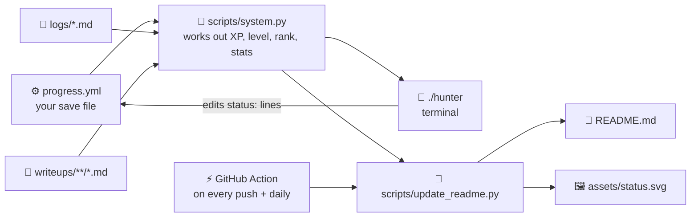

# 📘 How this repo works

Everything here is plain text files plus two small Python programs. Nothing is magic. This page walks through every piece so you understand (and can change) all of it.



## 1. ⚙️ `progress.yml`: the save file

[YAML](https://yaml.org/) is a way of writing data that humans can read. Indentation matters (2 spaces, never tabs).

```yaml
phases:                 # a list of paths
  - id: lab             # "- " starts a new item in a list
    name: Set up your lab
    skills:
      - name: Install Kali in VirtualBox
        status: done    # done | next | later
        core: true      # ⭐ must-know
```

Sections in the file:

| Section | What it controls |
|---|---|
| `xp` | How much XP each thing is worth, and XP per level |
| `ranks` | Which level each rank starts at, and the job title |
| `stats` | Which paths train STR / AGI / SEN / VIT / INT |
| `phases` | Your paths and skills |
| `quests` | Main story quests: objectives, reward, linked quiz |
| `achievements` | Badges that unlock automatically |

You can edit any of it. Add a skill, invent a quest, change the XP values. The README and `./hunter` follow along.

## 2. 🧠 `scripts/system.py`: the brain

Both `./hunter` and the README bot import this one file, so they always agree. Its `compute()` function:

1. **Loads** `progress.yml` with PyYAML and cleans up typos (an unknown status becomes `later`).
2. **Counts** your logs (files named like `2026-10-30.md`) and your write-ups.
3. **Works out the streak:** walks backwards one day at a time from today while a log exists.
4. **Adds up XP** from skills, quests, logs and boxes.
5. **Unlocks achievements.** Each one has one rule (`skill:`, `phase:`, `quest:`, `boxes:`, `streak:`, `logs:` or `level:`). Each unlocked one adds XP.
6. **Level** = `1 + total_xp // per_level` (`//` means divide and round down). The leftover (`%`, the remainder) fills the XP bar.
7. **Rank and job:** the highest rank whose `from:` level you've reached.
8. **Stats:** `10 + 3 × skills done` in the paths that train each stat.

## 3. 🐍 `./hunter`: the System in your terminal

A Python program with a `#!/usr/bin/env python3` first line (a **shebang**), so `./hunter` runs it directly once it's executable (`chmod +x hunter`).

| Trick | How it's done |
|---|---|
| 🎨 Colours | ANSI escape codes like `\033[38;5;39m` (blue) and `\033[0m` (reset). The terminal reads them as instructions, not text |
| ⌨️ Typewriter effect | Print one character, `flush()` so it shows now, `sleep(0.012)`, repeat |
| 🪟 The window border | Box-drawing characters `╔ ═ ╗ ║ ╚ ╝`. Each row is padded to the same *visible* width (colour codes are stripped before measuring) |
| 🎉 Level-up flash | Print the banner, then `\033[6A` moves the cursor 6 lines up, so the next colour prints over it |
| 🔀 Quiz shuffle | `random.shuffle` mixes the questions and options; it remembers the right answer by its text, not its letter |
| ✏️ Saving progress | Finds the right `status:` line in `progress.yml` and changes only that line, so your comments survive |
| ⚡ `--fast` | Skips every `sleep`. Used automatically when output isn't a real terminal |

## 4. 🤖 The README bot

`README.md` contains invisible marker pairs:

```html
<!--PROGRESS:START-->
...anything in here gets replaced...
<!--PROGRESS:END-->
```

`scripts/update_readme.py` builds fresh markdown for each section (badges, status, quests, progress, skill tree, achievements, latest log) and swaps it in with a regular expression. Text outside the markers is never touched, so you can edit the rest of the README freely.

- 🏷️ **Badges** come from [shields.io](https://shields.io): the text is in the image URL, so changing the URL changes the badge.
- 🌳 **The skill tree** is [Mermaid](https://mermaid.js.org/): text like `lab --> linux` that GitHub draws as a diagram.

## 5. 🖼️ `assets/status.svg`: the animated status window

SVG is an image written as text (XML). `scripts/status_svg.py` writes it with your current numbers. The animation is plain CSS inside the SVG:

```css
.fill { transform: scaleX(0); animation: grow 1.4s forwards; }
@keyframes grow { to { transform: scaleX(1) } }
```

The bars start at 0 width and grow to full. Lines fade in one after another using `animation-delay`. The frame pulses with `stroke-opacity`. A `@media (prefers-reduced-motion)` rule turns animation off for people who ask their system for less motion.

## 6. ⚡ The GitHub Action

`.github/workflows/update-readme.yml` tells GitHub: *whenever I push changes to these files, or once a day at 07:17 UTC, start a fresh Linux machine, install PyYAML, run the bot, and commit the result if anything changed.* The daily run keeps the **Day** and **Streak** badges honest even when you don't push.

See every run under the repo's **Actions** tab. A ❌ there means the bot crashed. Usually that's a YAML typo in `progress.yml`, and the run's log names the line.

## 7. 🛡️ `.gitignore`

A list of file patterns git refuses to upload: VPN files (`*.ovpn`), packet captures, hashes, raw scan output, loot. Public repos are public forever, so the safety net is built in.

## 🧪 Try changing things

- Give yourself a new quest in `progress.yml`, then run `./hunter quest`.
- Change `per_level: 375` to `300` and watch your level jump in `./hunter`.
- Add a word to `quizzes/codex.yml`, then `./hunter codex <word>`.
- Write your own quiz: copy `quizzes/nmap.yml` to `quizzes/mytopic.yml`, then `./hunter quiz mytopic`.
