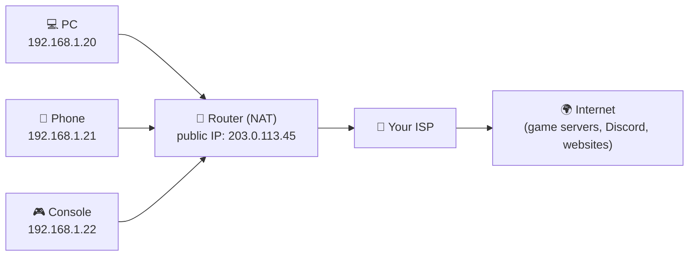

# 🛰️ Network tracking & privacy

> **The question:** can someone find where I live just from playing in the same match, or chatting on Discord?
>
> **The short answer:** from your **IP address alone**, someone can usually guess your **country**, often your **region**, sometimes your **city**, and your **internet provider**. They **can't** get your street or house from it. When people really get found ("doxxed"), it's almost always from **things they shared themselves**: usernames, photos, school names, friends' posts.

This lesson explains exactly why, with hands-on exercises you run **on yourself only**.

---

## 🧭 1. Your two IP addresses

Your devices have **private** addresses that only work inside your home. Your router has **one public** address that the whole internet sees.



- **Private ranges** (never seen on the internet): `10.x.x.x`, `172.16–31.x.x`, `192.168.x.x`
- **NAT** (Network Address Translation): the router swaps your private address for its public one on the way out, and back on the way in. That's why every device in your house looks like one address from outside.
- **CGNAT**: many ISPs (especially mobile) put *hundreds of customers* behind one public IP. Then your "location" is really your ISP's hub.

### 🧪 Exercise 1: find both of yours (Kali)

```bash
ip a                              # your PRIVATE address (inside VirtualBox: 10.0.2.15)
curl -s https://ipinfo.io/json    # your PUBLIC address and what the internet guesses about it
```

Look at `city`, `region` and `org` (your ISP). **Is the city right? Wrong? Close?** Write it in your log. Most people find it's off by a town or more.

> Inside VirtualBox NAT, Kali shares your Windows PC's public IP, so this shows your real home connection.

## 📍 2. How IP geolocation works (and why it's fuzzy)

Nobody "tracks" an IP to a house in real time. Companies build **databases** that map **blocks** of addresses to places, using:

- **Registries**: every IP block is registered to an organisation (your ISP) in a region
- **ISP hints**: the names of the ISP's routers often contain city codes
- **Guesswork from data**: apps and sites that know a user's location in other ways

Typical accuracy:

| Level | Roughly right |
|---|---|
| 🌍 Country | ~95–99% |
| 🗺️ Region / state | ~75–90% |
| 🏙️ City | ~50–80% |
| 🏠 Street / house | ❌ not possible from the IP alone |

The **only** organisation that knows which house used an IP at a given time is **your ISP**, and it hands that over to police with a court order, not to a random gamer.

**What a stranger CAN do with your IP:** guess your rough area and ISP, and (in old peer-to-peer games) flood your connection to knock you offline. That's called a DDoS, and it's illegal. **What they can't do:** walk to your door.

## 🎮 3. How games connect

| Model | How it works | Do other players see your IP? |
|---|---|---|
| 🖧 **Dedicated server** | Everyone connects to the game company's server | ❌ No. Only the server sees it |
| 🔁 **Relay** | Players talk *through* a middleman (e.g. Steam Datagram Relay) | ❌ No. The relay hides it |
| 🔗 **Raw peer-to-peer (P2P)** | Players connect **directly** to each other or to a player "host" | ⚠️ **Yes**, every player can see every other player's IP |

Most big competitive games today use dedicated servers or relays exactly because raw P2P leaks IPs. Some older games, small indie games, and some console party/co-op modes still use P2P.

### 🧪 Exercise 2: what does YOUR game use?

Search: `"<your game> dedicated servers or peer to peer"`. Check the game's official support pages or developer posts. Write the answer in your log.

## 💬 4. Discord and chat apps

- 🎙️ **Voice and video calls** go through **Discord's own servers**, so the people in your call don't get your IP from the call itself.
- 🔗 **Links are the real risk.** Any website you open sees your IP. That's literally how websites work. So-called "IP logger" links are just websites that save the address of whoever opens them. **Don't open links from strangers**, even ones that look like images or game skins.
- 🖼️ **What you share is the bigger risk:** your face, your school jersey, the view from your window, your real first name plus your town.

## 🕵️ 5. How people actually get found: OSINT

**OSINT** (Open-Source Intelligence) means collecting information that's already public. Doxxing is usually just OSINT plus patience:

1. 🏷️ **The same username everywhere.** Your game tag on Discord, Reddit, an old YouTube channel, Instagram…
2. 🧩 **Each account leaks one small piece:** a first name here, a school there, a birthday, a city.
3. 📸 **Photos** can carry hidden **EXIF** data (sometimes GPS coordinates), and backgrounds show landmarks.
4. 🔓 **Old data breaches** link your email to accounts.
5. 🧷 Put the pieces together → a real identity.

None of that needs your IP.

### 🧪 Exercise 3: OSINT yourself (only yourself)

1. Search each of your usernames in quotes: `"YourGamerTag"`. List every account you find in your log.
2. Check your email at [haveibeenpwned.com](https://haveibeenpwned.com/).
3. Check one of your **own** photos for hidden data on Kali:
   ```bash
   exiftool my_photo.jpg | grep -i -E "gps|date|model"
   exiftool -all= my_photo.jpg      # strips it (keeps a backup copy as my_photo.jpg_original)
   ```
4. Ask yourself: *could a stranger connect these accounts to each other?*

## 🦈 6. Watch your own traffic

Seeing your own packets shows what any network you use can see.

```bash
sudo wireshark     # pick eth0, press the blue shark fin to start
```

Then in Kali's Firefox visit a couple of websites, and stop the capture. Try these display filters:

| Filter | Shows |
|---|---|
| `dns` | Every website name your machine looked up. Your network (and ISP) can see these |
| `tls.handshake.extensions_server_name` | The website name inside HTTPS connections, which is visible even though the page itself is encrypted |
| `tcp.flags.syn == 1 && tcp.flags.ack == 0` | Every new connection your machine started |

Then open **Statistics → Endpoints → IPv4** to see every address your machine talked to.

**Lesson:** HTTPS hides *what* you read, but not *which sites* you visit. A VPN moves that visibility from your ISP to the VPN company.

## 🔒 7. Lock it down

- [ ] 🔗 Don't open links from strangers in Discord or game chats
- [ ] 🏷️ Use different usernames for gaming and for personal or school accounts
- [ ] 📸 Strip EXIF from photos before posting, and check backgrounds
- [ ] 💬 Discord: Settings → **Privacy & Safety**, limit DMs from server members, and turn on **Streamer Mode** when streaming
- [ ] 🎮 Steam / console: set profile and friends list to Friends Only
- [ ] 📶 Router: change the default admin password and keep its firmware updated
- [ ] 🛡️ VPN (optional): hides your home IP from game peers and websites. The VPN company sees your traffic instead, so pick a reputable one. Free VPNs often pay for themselves with your data
- [ ] 🚨 If someone threatens to dox you: don't reply, screenshot everything, report and block them on the platform, and tell someone you trust

## ⚖️ The rule

Everything here is for **understanding and protecting yourself**. Looking up, collecting or posting someone else's personal information, grabbing other players' IPs, or knocking anyone offline can be **illegal** and can hurt real people. The hacker skill that matters most is knowing where the line is.

**Quiz yourself:** `./hunter quiz privacy`
